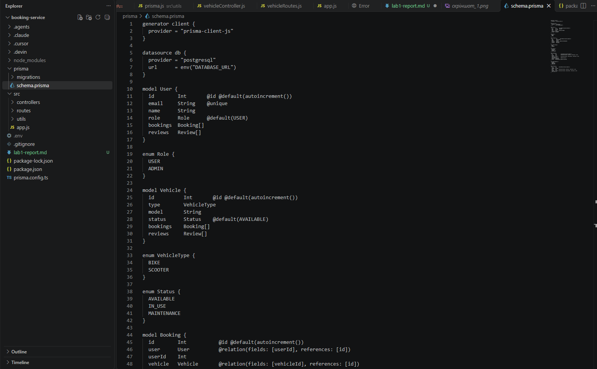
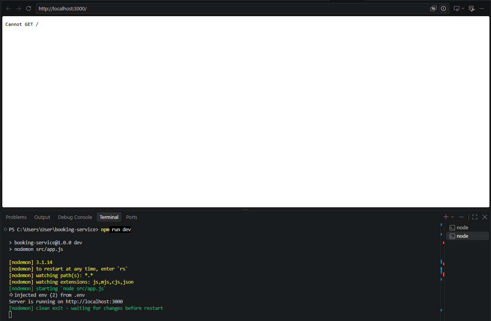
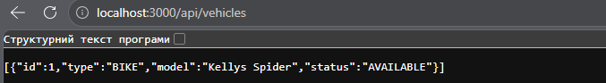
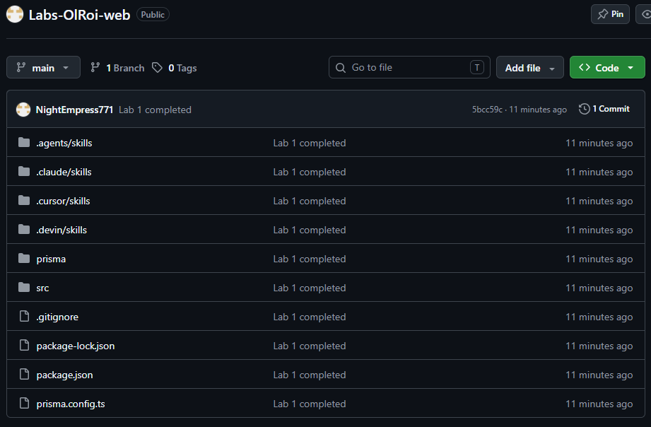

# Звіт з лабораторної роботи №1

**Тема:** Розроблення backend архітектури та основного функціоналу  
**Виконав:** студент групи ІПЗ-42 Бугайчук Денис  
**Предметна область:** Система бронювання (Вебсервіс для оренди велосипедів і самокатів)

---

## 1. Мета роботи
Здобути практичні навички створення серверної частини вебдодатку з використанням сучасних технологій Node.js та Express.js, навчитися проектувати структуру бази даних (PostgreSQL) та реалізовувати базові операції з даними за допомогою Prisma ORM.

## 2. Структура бази даних
Було спроектовано 4 основні сутності для предметної області "Система бронювання":
- **User** (Користувачі сервісу з ролями USER/ADMIN)
- **Vehicle** (Транспортні засоби: велосипеди та самокати, їх статус)
- **Booking** (Бронювання: зв'язок між користувачем та транспортом, фіксація часу оренди)
- **Review** (Відгуки користувачів про конкретний транспорт)

Зв'язки між сутностями реалізовані як "один-до-багатьох": один користувач може мати багато бронювань та відгуків, один транспортний засіб може мати багато бронювань та відгуків.

## 3. Хід роботи та результати (Скріншоти)

### 3.1. Структура проєкту та налаштування ORM
Створено базову структуру проєкту, налаштовано підключення до PostgreSQL через файл `.env` та описано моделі у `schema.prisma`.

### 3.2. Запуск сервера
Реалізовано контролери та маршрути. Сервер успішно запущено на порту 3000 за допомогою `nodemon`.

### 3.3. Тестування API
Виконано перевірку працездатності створених endpoints (додавання та отримання транспорту).

### 3.4. Публікація коду
Код проєкту успішно завантажено до системи контролю версій.
*(Встав свій скріншот сторінки репозиторію на GitHub)*

**Посилання на GitHub репозиторій:** [ВСТАВ_СВОЄ_ПОСИЛАННЯ_ТУТ]

---

## 4. Відповіді на контрольні запитання

1. **Що таке Node.js і які його основні переваги?**
   Node.js — це середовище виконання JavaScript на стороні сервера. Основні переваги: асинхронна (non-blocking) модель вводу/виводу, висока продуктивність завдяки рушію V8, використання єдиної мови (JS) для фронтенду та бекенду, величезна екосистема пакетів (npm).

2. **Різниця між синхронними та асинхронними операціями в Node.js.**
   Синхронні операції блокують виконання потоку, поки не завершаться. Асинхронні операції (наприклад, звернення до БД) дозволяють програмі продовжувати виконання іншого коду, очікуючи на результат у фоновому режимі (через `async/await` або колбеки).

3. **Що таке Express.js middleware?**
   Middleware — це функції, які виконуються в процесі обробки запиту. Вони мають доступ до об'єктів `req`, `res` та функції `next()`. Використовуються для парсингу JSON (`express.json()`), логування, перевірки авторизації чи обробки CORS.

4. **Що таке ORM і переваги Prisma?**
   ORM — це технологія, яка дозволяє працювати з базами даних через об'єкти в коді, а не через сирі SQL-запити. Prisma забезпечує строгу типізацію, автоматичну генерацію клієнта на основі схеми та зручну систему міграцій.

5. **Принципи REST API та HTTP методи.**
   REST базується на маніпуляції ресурсами через стандартні HTTP методи: 
   - `POST` — створення (Create)
   - `GET` — читання (Read)
   - `PUT`/`PATCH` — оновлення (Update)
   - `DELETE` — видалення (Delete)

6. **Що таке валідація даних на сервері?**
   Це перевірка вхідних даних від клієнта (формат, типи, обмеження) перед їх обробкою. Вона захищає БД від некоректних записів та підвищує безпеку. У роботі реалізована за допомогою бібліотеки `Joi`.

7. **Структура MVC у проєкті.**
   Проєкт розділений на логічні шари:
   - **Model**: Описана у `schema.prisma`, взаємодія йде через `PrismaClient`.
   - **Controller**: Логіка обробки запитів (`src/controllers/`).
   - **View**: Роль представлення виконують JSON-відповіді, що відправляються клієнту.

8. **Як працює система міграцій бази даних в Prisma?**
   Prisma порівнює поточну схему у файлі `.prisma` зі станом бази даних, генерує необхідні SQL-скрипти (міграції) та застосовує їх для синхронізації структури БД.

9. **Що таке змінні середовища (.env)?**
   Це конфігураційні змінні, які зберігаються поза кодом. Використовуються для безпечного збереження конфіденційних даних (паролі, ключі, `DATABASE_URL`), щоб вони не потрапили у публічний репозиторій.

10. **Як забезпечити безпеку API endpoints?**
    Використовувати HTTPS, впровадити аутентифікацію (наприклад, JWT), авторизацію (ролі), обов'язкову валідацію вхідних даних, лімітування запитів (rate limiting) та налаштування CORS.

---

## 5. Висновок
Під час виконання лабораторної роботи було спроєктовано та створено базову архітектуру бекенду для сервісу бронювання велосипедів та самокатів. Налаштовано середовище Node.js з Express.js, спроєктовано базу даних PostgreSQL за допомогою Prisma ORM, реалізовано маршрути та контролери для базових CRUD операцій із застосуванням валідації через Joi.