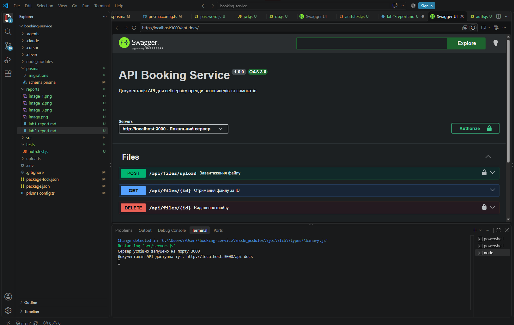
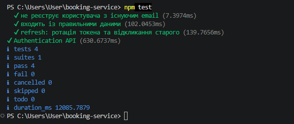

# Звіт з лабораторної роботи №2

**Тема:** Аутентифікація, авторизація та розширений функціонал  
**Виконав:** студент групи ІПЗ-42 Бугайчук Денис  
**Предметна область:** Система бронювання (Вебсервіс для оренди велосипедів і самокатів)

---

## 1. Мета роботи
Здобути практичні навички реалізації системи аутентифікації та авторизації користувачів, впровадити безпечне зберігання паролів (Argon2id), управління сесіями (JWT), файловий сервіс, а також створити автоматичну документацію API через Swagger.

## 2. Хід роботи та результати (Скріншоти)

**2.1. Документація Swagger UI**  
Сервер працює, документація згенерована автоматично на основі JSDoc-коментарів. Реалізовано маршрути автентифікації, роботи з файлами та управління транспортом.

**2.2. Автоматичні тести**  
Написано та успішно виконано тести для перевірки реєстрації, логіну та ротації refresh-токенів за допомогою вбудованого модуля `node:test` та `supertest`.

---

## 3. Відповіді на контрольні запитання

1. **Різниця між аутентифікацією та авторизацією:**
   - **Аутентифікація** — це перевірка "Хто ви?" (введення email та пароля, перевірка правильності JWT).
   - **Авторизація** — це перевірка "Що вам дозволено?" (наприклад, перевірка наявності ролі `ADMIN` перед створенням нового транспорту).

2. **Що таке JWT токен:**
   JSON Web Token — це компактний формат для передачі даних, що складається з 3 частин (Header, Payload, Signature). Він містить корисні дані (наприклад, ID користувача) і захищений криптографічним підписом. Його головна перевага — відсутність потреби зберігати сесії на сервері (stateless архітектура).

3. **Argon2id vs швидкі хеш-функції:**
   Argon2id розроблений так, щоб бути повільним і вимогливим до оперативної пам'яті. Це робить масовий підбір паролів (brute-force) на відеокартах економічно невигідним, на відміну від швидких алгоритмів типу SHA-256. *Сіль (salt)* — це унікальний випадковий рядок, що додається до пароля перед хешуванням, щоб унеможливити використання райдужних таблиць (навіть однакові паролі матимуть різні хеші).

4. **Принцип роботи middleware в Express.js:**
   Middleware — це функції, які перехоплюють запит до того, як він дійде до основного контролера. 
   - `authenticate` перевіряє наявність і валідність JWT-токена в заголовках `Authorization`.
   - `authorize` перевіряє, чи має збережений у `req.user` користувач необхідну роль для виконання дії.

5. **Що таке RBAC:**
   Role-Based Access Control — це контроль доступу на основі ролей. У проєкті створено `enum Role { USER, ADMIN, MODERATOR }`. Звичайні користувачі можуть переглядати транспорт, а створювати чи видаляти його може лише адміністратор.

6. **Як працює Multer:**
   Це middleware для обробки `multipart/form-data`. У проєкті він зберігає файли в локальну папку `uploads`, генеруючи унікальні імена для уникнення перезапису файлів. Реалізовано перевірку MIME-типу, розширення файлу та ліміт на розмір завантаження.

7. **Як реалізовано пагінацію:**
   Для пагінації у Prisma використано опції `skip` (скільки записів пропустити) та `take` (скільки взяти). Ці значення динамічно вираховуються на основі параметрів `page` та `limit`, що приходять із рядка запиту `req.query`.

8. **Що таке Swagger:**
   Це набір інструментів для стандартизованого опису REST API. Він автоматично генерує інтерактивний вебінтерфейс на основі коментарів у коді. Основна перевага — можливість фронтенд-розробникам миттєво зрозуміти структуру запитів і протестувати їх прямо з браузера.

9. **Загрози безпеки та їх мінімізація:**
   - *Brute-force*: впроваджено Rate Limiting (обмеження до 100 запитів на 15 хв з однієї IP).
   - *Витік даних через HTTP-заголовки*: використано пакет `helmet`.
   - *Злам бази даних*: використано стійкий алгоритм хешування Argon2id.
   - *Міжсайтові запити*: налаштовано CORS політику для безпечної взаємодії з клієнтом.

10. **Access vs Refresh токени:**
    - **Access токен** короткоживучий (наприклад, 15 хв). Використовується для доступу до захищених ресурсів.
    - **Refresh токен** довгоживучий (наприклад, 7 днів). Використовується лише для запиту нової пари токенів, коли Access протерміновано.
    *Ротація* — це механізм безпеки: при використанні Refresh токена він одразу стає недійсним (відкликається), а користувач отримує повністю нову пару. Якщо хтось викраде Refresh токен і спробує його використати повторно, сервер скасує всі токени цього користувача.