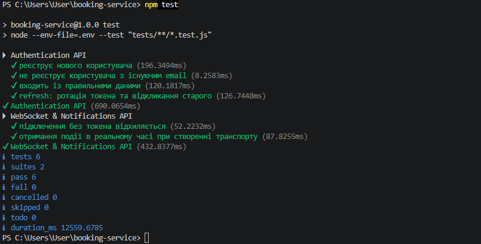

# Звіт з лабораторної роботи №3

**Тема:** Взаємодія в реальному часі та фіналізація серверної частини  
**Виконав:** студент групи ІПЗ-32 Бугайчук Денис  
**Предметна область:** Система бронювання (Вебсервіс для оренди велосипедів і самокатів)

---

## 1. Мета роботи
Здобути практичні навички впровадження обміну даними в реальному часі за допомогою WebSocket (Socket.io), навчитися оптимізувати базу даних (через індекси) та проводити комплексне тестування.

## 2. Хід роботи та результати

1. **Інтеграція WebSocket:** Налаштовано сервер `Socket.io`, який працює поверх HTTP-сервера. Реалізовано перевірку JWT-токена під час підключення (`auth.token`).
2. **Система сповіщень та Real-time оновлення:** Створено нову сутність `Notification`. Налаштовано логіку, за якої створення нового транспорту генерує WebSocket-подію `vehicle:created`, яку миттєво отримують всі підключені клієнти.
3. **Оптимізація БД:** У файл `schema.prisma` додано директиви `@@index` для полів, які часто використовуються у фільтрації (наприклад, `userId`, `vehicleId`, `type`, `status`). Це дозволяє базі даних використовувати `Index Scan` замість повільного `Seq Scan`.
4. **Тестування:** Написано тести з використанням `socket.io-client`, які перевіряють, чи правильно сервер відхиляє неавторизовані з'єднання та чи коректно відправляє broadcast-події.

---

## 3. Відповіді на контрольні запитання

1. **Чим WebSocket відрізняється від HTTP та polling?**
   HTTP — це односторонній зв'язок (клієнт просить, сервер відповідає). Polling — це коли клієнт постійно питає сервер "чи є щось нове?", що перевантажує мережу. WebSocket — це постійний двосторонній канал, де сервер сам миттєво "штовхає" дані клієнту. Виправданий для чатів, статусів онлайн, трекінгу транспорту.

2. **Що додає Socket.io порівняно з чистим WebSocket?**
   Socket.io додає автоматичне перепідключення при обривах, підтримку "кімнат" (rooms), легку розсилку всім клієнтам (broadcast) та автоматичний fallback на long-polling, якщо WebSockets блокуються фаєрволом. Через цей додатковий шар логіки звичайний клієнт не може підключитися до сервера Socketі.io.

3. **Кімнати (rooms) vs простори імен (namespaces):**
   Namespaces — це логічне розділення логіки (наприклад, `/admin` і `/chat`). Rooms — це динамічні групи всередині одного namespace. У проєкті кімнати використано для створення приватної кімнати користувача (`user:${userId}`), щоб надсилати йому персональні сповіщення.

4. **Автентифікація WebSocket:**
   При встановленні з'єднання (handshake) клієнт передає JWT-токен. Сервер перевіряє його через `verifyAccessToken`. Якщо токен спливає під час сесії, клієнт має отримати новий токен через `refresh` endpoint і вручну перепідключити WebSocket з новим токеном.

5. **Оптимізація бази даних (Індекси):**
   B-tree індекс працює як алфавітний покажчик у книзі, дозволяючи швидко знаходити дані без перегляду кожної сторінки (`Seq Scan`). Індекси було додано на зовнішні ключі (`userId`, `vehicleId`) та поля статусу/типу, за якими часто відбувається сортування або пошук `WHERE`. Ціна індексу — сповільнення операцій запису (INSERT/UPDATE), бо БД повинна оновлювати і таблицю, і її індекс.

6. **Проблема N+1:**
   Виникає, коли для отримання списку з 10 записів (1 запит) БД робить ще 10 додаткових запитів, щоб підтягнути зв'язані дані (разом 11 запитів). У Prisma вирішується за допомогою використання `include` або `relationLoadStrategy: 'join'`, що змушує БД об'єднати дані (JOIN) і повернути все за один раз.